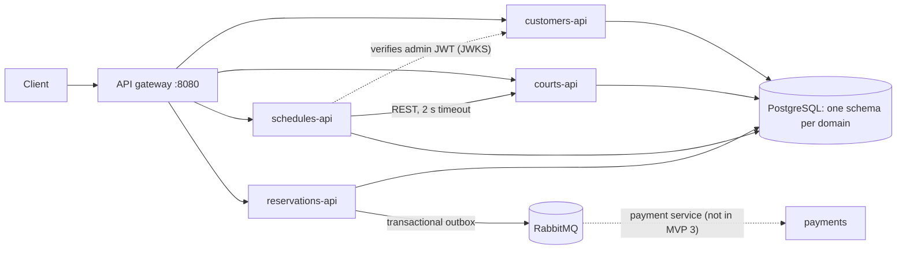

# Futbolix: a distributed court-reservation system

> Final project of *Sistemas Distribuidos 2026-B* (CORHUILA). A team of microservices that lets
> people reserve the four football courts of a sports facility online, without double booking,
> and keeps answering when a dependency goes down.

**My role:** infrastructure and the schedules domain (shared PostgreSQL, `ftx-schedules-db`,
`ftx-schedules-api`), plus operating the whole platform: integration, failure demo and runbooks.

[Demo video (8 min, with injected failures)](https://drive.google.com/file/d/1K_BMUNiHh3nW5tkY-iYpUWs3uGiyzHGr/view?usp=sharing)
· [Documentation](https://github.com/code-corhuila/ftx-docs)
· [Runbooks and demo transcript](https://github.com/code-corhuila/ftx-docs/pull/69)

## Architecture

Microservices with an event-driven reservation flow and hexagonal architecture inside each
service. One PostgreSQL instance with **one schema and one pair of roles per domain**, so no
service can read another's tables. A single entry point, the API gateway, strips untrusted
headers, adds a correlation id and rate-limits.



The full C4 diagrams are in [`ftx-docs/05-architecture`](https://github.com/code-corhuila/ftx-docs/tree/main/05-architecture).

## Decisions worth reading (ADRs)

| ADR | What it decides | Why it matters |
|---|---|---|
| ADR-003 | Database per service | Enforced with schemas and NOLOGIN reader/writer roles, not just by convention |
| ADR-004 | API gateway as the only entry | One place for rate limit, correlation id and header sanitising |
| ADR-006 | Transactional outbox | A reservation is not lost, nor its event, while the broker is down |
| ADR-010 | Choreographed saga | No central orchestrator; each service reacts to events |
| ADR-013 | Role of the workflow repo and the gateway edge | The platform is brought up from one place with one script |

## What I built and operated

- **Shared PostgreSQL and migrations.** Flyway migrations per domain, roles with least
  privilege, and a runner that only starts on purpose (`--profile tooling`).
- **Schedules domain.** Bookable-slot rules, schedule management for administrators, and a
  client to the courts service that fails fast: it answers **503 in about 2 s** instead of
  hanging when courts is down.
- **Platform integration.** Brought the full stack up on my own machine (database, four
  migrations, RabbitMQ, four APIs, gateway) and fixed what blocked it, for example the JWT
  private key format (one-line PKCS#8 base64) that stopped `ftx-customers-api`.
- **Failure demo.** `demo-falla.bat` runs the happy path and then injects failures:
  **20 PASS / 0 FAIL**. With RabbitMQ down a reservation is still created and its event waits in
  the outbox; with PostgreSQL stopped, schedules answers 503 and **recovers to 200 without
  restarting the API** once the database is back.
- **Runbooks.** [RB-001 (PostgreSQL unavailable)](https://github.com/code-corhuila/ftx-docs/pull/69)
  and RB-002 (`ftx-schedules-api`), with the evidence of the rehearsal.

## How I worked

Git flow per environment (`develop`, `qa`, `main`), promotion by `git cherry-pick -x`,
Conventional Commits, and one approval from the instructor for `main`. GitHub Actions was blocked
by the organisation's billing, so every check was run locally and its output kept as evidence.
My weekly `hu-status` reports in my fork are the history of this work.

## Known limits (stated openly)

- The payment service with Wompi is not in MVP 3; reservations stay `PENDING`.
- There is no public deployed environment: the system runs with Docker Compose.
- Some repositories were still waiting for merge and the `v3.0.0` tag when this was written.

## Run it

```
git clone https://github.com/code-corhuila/ftx-workflow
cd ftx-workflow
start-platform.bat      # database, migrations, broker, services and gateway
demo-falla.bat          # happy path and injected failures
```

## What I would do differently

- Define the platform network and environment variables once, up front, instead of fixing the
  name across repositories at the end.
- Get CI running (or a local equivalent in the repo) from the first sprint, so "tests pass" is a
  file in Git and not a screenshot.
- Write the failure-mode runbook while building the service, not after.
